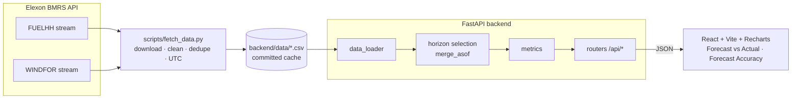

# Wind Forecast Monitor

A full-stack app for a UK energy utility that buys power on the GB day-ahead market. It shows
the **national wind generation forecast that was actually available at decision time** next to
what the wind farms really produced, and measures **how wrong those forecasts were**, so traders
can size a buffer for forecast error when they buy.

- **Data:** Elexon BMRS, national wind only. Actuals come from `FUELHH` (`fuelType = WIND`) and
  forecasts from `WINDFOR`.
- **Scope:** target times 2026-01-01 00:00 to 2026-01-31 23:30 UTC.
- **Live deployment:** <https://forecast-dun-iota.vercel.app> (frontend on Vercel, API on
  Render at <https://forecast-m8e5.onrender.com/api/health> — see [Deployment](#deployment))

## The business problem

Wind supplies a large, volatile share of GB electricity. A utility that buys day-ahead commits
volumes hours before delivery, using whatever wind forecast has been published by then. If wind
comes in below forecast, the shortfall has to be bought later, usually at worse prices. The team
needs two things:

1. **Monitoring:** see the forecast they could actually have used for each hour, against the
   outturn.
2. **Evaluation:** a quantitative picture of forecast error (size, direction, and how it grows
   with lead time and varies by hour) to turn into a buffer rule.

## The forecast horizon, explained

Elexon republishes the wind forecast several times a day (roughly every 2–4 hours), and each
publication covers the next ~48 hours. So any given hour has **many** forecasts, made at
different times.

The **horizon H** answers: _"If I must decide H hours before delivery, which forecast do I
have?"_ For each target time **T**:

> Use the forecast with the **latest publish time that is ≤ T − H**. Ignore forecasts published
> more than 48 h before T. If nothing qualifies, leave the value blank. Never borrow a later
> forecast.

**Example (illustrative values).** Target T = 10 Jan 12:00, horizon H = 4 h, so the cutoff is 08:00.

| Publish time | Forecast | Eligible?                      |
| ------------ | -------- | ------------------------------ |
| 10 Jan 02:30 | 9,800 MW | yes                            |
| 10 Jan 07:30 | 9,450 MW | **yes, latest before 08:00**   |
| 10 Jan 09:30 | 9,200 MW | no, published after the cutoff |

The 4 h-ahead forecast for 12:00 is **9,450 MW**, published 4.5 h ahead. Because publications
are discrete, the _effective_ lead time is always ≥ H. At H = 24 h it averages 25.6 h.

This lookup is implemented with a vectorised `pandas.merge_asof` (`by=start_time`,
`direction="backward"`) in [`backend/app/services/horizon.py`](backend/app/services/horizon.py)
and covered by unit tests for the exact-boundary, no-qualifying-forecast, >48 h and
no-fallback cases.

## Analysis findings (January 2026)

All figures are computed from the cached data by the app's own metrics service, over 744 hourly
target slots, with error = forecast − actual. Mean actual wind output was **11,581 MW**.

| Horizon | Coverage | MAE      | RMSE     | Bias (mean error) | nMAE  | P90 abs error | P95 abs error |
| ------- | -------- | -------- | -------- | ----------------- | ----- | ------------- | ------------- |
| 0 h     | 100%     | 1,794 MW | 2,281 MW | +1,592 MW         | 15.5% | 3,764 MW      | 4,637 MW      |
| 4 h     | 100%     | 1,836 MW | 2,332 MW | +1,645 MW         | 15.9% | 3,899 MW      | 4,672 MW      |
| 12 h    | 100%     | 1,898 MW | 2,379 MW | +1,704 MW         | 16.4% | 3,897 MW      | 4,591 MW      |
| 24 h    | 100%     | 2,050 MW | 2,518 MW | +1,854 MW         | 17.7% | 4,129 MW      | 5,097 MW      |
| 36 h    | 100%     | 2,259 MW | 2,750 MW | +1,951 MW         | 19.5% | 4,263 MW      | 5,422 MW      |
| 42 h    | 100%     | 2,307 MW | 2,836 MW | +1,939 MW         | 19.9% | 4,483 MW      | 5,599 MW      |
| 46 h    | 62.5%    | 2,454 MW | 2,999 MW | +2,068 MW         | 21.4% | 4,670 MW      | 5,681 MW      |

Key takeaways:

1. **The forecast was systematically too high.** WINDFOR over-forecast outturn in **~87%** of
   hours, by **+1.6 GW at 4 h** and **+1.85 GW at 24 h** on average. Most of the error is bias,
   not noise. One plausible cause is that `FUELHH` reports metered output _after_ curtailment and
   constraint actions, while the forecast reflects available wind. That is a hypothesis, not
   something this dataset can prove.
2. **Day-ahead buffer.** At a **24 h** horizon, a buffer of **~4.1 GW** covered 90% of forecast
   misses, and **~5.1 GW** covered 95%. Because misses were almost always shortfalls, this is in
   practice a one-sided buffer: wind under-delivered by more than 4.1 GW in only 10% of hours.
3. **Bias correction is the biggest lever.** Subtracting the January mean bias would cut 24 h
   MAE from 2,050 MW to ~1,324 MW, and P90 abs error from 4,129 MW to ~2,892 MW. This is
   in-sample, so it would need validating on other months before use.
4. **Error grows gently with horizon.** MAE rises ~14% from 0 h to 24 h (1,794 → 2,050 MW) and
   ~29% by 42 h. Committing a day ahead costs ~256 MW of extra MAE versus the latest forecast.
5. **Time of day matters.** Errors peak overnight and early morning (**05:00 UTC**: MAE ~2.5 GW,
   bias +2.4 GW at 24 h) and are lowest mid-afternoon (**16:00 UTC**: MAE ~1.7 GW).
6. **Shape is good, level is off.** Forecast and actual correlate at **0.94** (24 h), so the
   forecast tracks the ramps well. Errors were largest at high output (>15 GW: MAE ~2.5 GW).
   The worst day was **11 Jan** (MAE ~5.0 GW) and the best were 9 and 19 Jan (~0.6 GW).
7. **Coverage.** WINDFOR extends ~47.6 h ahead, so coverage is 100% up to 43 h and then falls
   (95.8% at 44 h, 62.5% at 46 h, 0% at 48 h).

## Architecture



The app never calls Elexon at runtime. It reads the committed CSV cache, so the deployment
keeps working if BMRS is down. Horizon selections are memoised per horizon.

| Layer      | Tech                                                              |
| ---------- | ----------------------------------------------------------------- |
| Data / API | Python 3.11+, FastAPI, pandas, NumPy, pydantic, pydantic-settings |
| Frontend   | React 19, TypeScript, Vite, Recharts                              |
| Quality    | pytest, ruff, black, ESLint, Prettier                             |
| Packaging  | Docker (multi-stage, nginx), docker compose                       |
| Hosting    | Vercel (static frontend) + Render (FastAPI backend)               |

### API

| Endpoint                                        | Returns                                                                       |
| ----------------------------------------------- | ----------------------------------------------------------------------------- |
| `GET /api/health`                               | status and dataset sizes                                                      |
| `GET /api/actuals?start=&end=`                  | half-hourly actual wind generation                                            |
| `GET /api/forecasts?start=&end=&horizon=`       | horizon-selected forecast per hour (with publish time and lead)               |
| `GET /api/comparison?start=&end=&horizon=`      | actual, forecast and error per hourly slot                                    |
| `GET /api/metrics?start=&end=&horizon=`         | MAE, RMSE, bias, MAPE, nMAE, P10/P50/P90/P95 of error and abs error, coverage |
| `GET /api/metrics/by-horizon?start=&end=&step=` | MAE, RMSE, bias and P90 abs error for horizons 0–48 h                         |
| `GET /api/metrics/by-hour?start=&end=&horizon=` | MAE, RMSE and bias by UTC hour of day                                         |

`start`/`end` are ISO-8601 (naive values are treated as UTC), default to the full month, and
are clamped to it. `horizon` is 0–48 (default 4). Interactive docs are at `/docs` when running
locally.

## Directory structure

```
.
├── backend/
│   ├── app/
│   │   ├── main.py           # FastAPI app factory, CORS, router registration
│   │   ├── config.py         # Settings (data dir, window, horizons) via env vars
│   │   ├── schemas.py        # Pydantic response models
│   │   ├── dependencies.py   # Shared query params (window, horizon) + serialisation
│   │   ├── routers/
│   │   │   ├── data.py       # /api/health, /actuals, /forecasts, /comparison
│   │   │   └── metrics.py    # /api/metrics, /by-horizon, /by-hour
│   │   └── services/
│   │       ├── data_loader.py  # Reads cached CSVs (UTC-parsed, memoised)
│   │       ├── horizon.py      # Core horizon selection (merge_asof)
│   │       ├── metrics.py      # Comparison builder and error statistics
│   │       └── analysis.py     # Per-horizon caching and window filtering
│   ├── data/
│   │   ├── actuals.csv       # FUELHH wind, 1,488 half-hourly rows
│   │   └── forecasts.csv     # WINDFOR, 11,873 rows (target in Jan, lead 0–48 h)
│   ├── scripts/
│   │   └── fetch_data.py     # Downloads and cleans the data from Elexon
│   ├── tests/                # pytest: horizon selection, metrics, API
│   ├── Dockerfile            # Backend image (also used by Render)
│   ├── pyproject.toml        # ruff, black and pytest config
│   ├── requirements.txt      # Runtime deps
│   └── requirements-dev.txt  # + test and lint tools
├── frontend/
│   ├── src/
│   │   ├── App.tsx           # Layout, tabs, shared window + per-view horizon state
│   │   ├── api/client.ts     # Typed API client (base URL from VITE_API_BASE_URL)
│   │   ├── hooks/useApi.ts   # Debounced async loader with loading/error state
│   │   ├── components/       # Controls, Panel/KPI cards, chart theme
│   │   ├── views/            # ForecastVsActual.tsx, ForecastAccuracy.tsx
│   │   ├── lib/format.ts     # MW / % / UTC date formatting
│   │   └── styles.css        # Dark trading-desk theme, responsive layout
│   ├── nginx.conf            # Static hosting + /api proxy for Docker
│   ├── Dockerfile            # Multi-stage: node build -> nginx
│   ├── vercel.json           # Vercel build settings (Root Directory = frontend)
│   └── .env.example
├── docker-compose.yml        # backend :8000 + frontend :8080
└── README.md
```

## How to run

### Locally (venv + npm)

```bash
# Backend (from the repo root)
python -m venv .venv
source .venv/bin/activate            # Windows: .venv\Scripts\activate
pip install -r backend/requirements-dev.txt
cd backend
uvicorn app.main:app --reload --port 8000

# Frontend (second terminal)
cd frontend
npm install
npm run dev                          # http://localhost:5173, proxies /api to :8000
```

The frontend reads `VITE_API_BASE_URL` (see `frontend/.env.example`). Leave it empty to call the
same origin, which works with the Vite proxy and Docker/nginx. Set it to point at a
backend on another host.

### Docker

```bash
docker compose up --build
# UI:  http://localhost:8080
# API: http://localhost:8000/api/health
```

### Refresh the data

```bash
python backend/scripts/fetch_data.py
```

This re-downloads both datasets, applies the same cleaning (UTC parsing, dedupe, sort, trim to
the target window and 0–48 h leads), and overwrites `backend/data/*.csv`. Requests retry
automatically on transient network errors.

### Tests and linting

```bash
cd backend
pytest                     # 26 tests: horizon selection, metrics, API
ruff check . && black --check .

cd ../frontend
npm run lint && npm run format:check && npm run build
```

### Deployment

The frontend and backend deploy separately from this repo.

**Backend → Render** (Web Service)

| Setting           | Value                                                 |
| ----------------- | ----------------------------------------------------- |
| Root Directory    | `backend`                                             |
| Runtime           | Docker (uses `backend/Dockerfile`), or Python 3 with: |
| Build Command     | `pip install -r requirements.txt`                     |
| Start Command     | `uvicorn app.main:app --host 0.0.0.0 --port $PORT`    |
| Health Check Path | `/api/health`                                         |
| Env (optional)    | `FORECAST_CORS_ORIGINS=https://<your-app>.vercel.app` |

The cached CSVs live in `backend/data`, so the API never depends on Elexon at runtime.
`FORECAST_CORS_ORIGINS` accepts one origin, a comma-separated list or a JSON list, and
defaults to `*`.

**Frontend → Vercel**

Set the project's **Root Directory** to `frontend`. `frontend/vercel.json` supplies the build
settings and a rewrite that proxies `/api/*` to the Render service. The browser only ever talks
to its own origin, so no CORS setup or `VITE_API_BASE_URL` is needed. If the Render URL changes,
update the rewrite destination.

Render's free tier sleeps when idle, so the first request after a pause can take up to a minute.

## Assumptions and scope decisions

- **Target window:** `startTime` from 2026-01-01 00:00 to 2026-01-31 23:30 UTC. All times are
  UTC end to end, and the UI labels them as such. In January, UK local time equals UTC, but
  FUELHH is queried by settlement date with one extra day on each side and then trimmed by UTC
  `startTime` to be safe.
- **Forecast publish window:** WINDFOR is fetched for publish times from **2025-12-29** onwards,
  so even the first January slots have 24–48 h-ahead forecasts. The cache keeps only rows that
  can ever be selected: target inside January and lead time between 0 and 48 h.
- **Forecast resolution:** WINDFOR is **hourly** while FUELHH is half-hourly. Accuracy is
  evaluated on the 744 hourly slots where both exist; actuals are not averaged or resampled. The
  chart still plots the half-hourly actuals, and the forecast line is drawn straight between
  hourly points. Tooltips only report real forecast values.
- **Duplicates/revisions:** for actuals, the latest published value per slot is kept. Forecasts
  are deduplicated on `(startTime, publishTime)`.
- **Error sign:** error = forecast − actual, so positive means wind under-delivered against
  forecast. "Coverage" is the share of hourly target slots in the window with a qualifying
  forecast at the chosen horizon.
- **Horizon 0 h** means the latest forecast published at or before the target time.
- **MAPE** is reported alongside nMAE (MAE ÷ mean actual). nMAE is more stable when output is
  low; January actuals never fell below 1.7 GW, so MAPE is well-defined here.
- **Bias-correction numbers** in the findings are in-sample and illustrative only.

## Use of AI tools

AI coding assistants were used during development of this project, to help with scaffolding,
implementation, tests, and documentation. All logic and the reported numbers were reviewed and
verified by running the code against the data.
